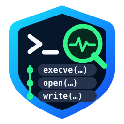

# ShellTrace — documentation française




**Comprendre les effets d'une commande Linux avant de lui faire confiance.**

ShellTrace est un outil CLI écrit en Rust et distribué sous licence **GPLv3 ou ultérieure**. Il combine les instantanés du système de fichiers avec l'observation des appels système de `strace` afin de fournir un rapport vérifiable. Son objectif n'est **pas** de promettre une visibilité totale sur toutes les modifications de la machine.

## Deux modes

**1. `run` : observation sur le système réel.** La commande est réellement exécutée, avec les droits de l'utilisateur. Toute modification, suppression ou connexion réseau est possible ; la comparaison des fichiers est limitée au répertoire indiqué par `--scope`.

**2. `sandbox` : essai dans Bubblewrap.** La commande s'exécute avec une racine hôte en lecture seule, un espace `/tmp/shelltrace-work` temporaire en écriture et un espace de noms réseau séparé. Les montages optionnels (par exemple `/media` et `/mnt`) sont ignorés si les répertoires correspondants n’existent pas sur l’hôte. Ce mode dépend des fonctionnalités de noyau disponibles et n'est **pas** une barrière de sécurité certifiée ; utiliser une VM pour les programmes réellement malveillants.

## Interface graphique Qt6

ShellTrace inclut une **interface native Qt6 Widgets**, disponible séparément du moteur Rust. Elle propose le mode sandbox par défaut, une confirmation obligatoire pour le mode hôte, des tableaux et filtres, un tableau de bord, ainsi que l'ouverture et l'enregistrement de rapports JSON. L'interface est en français ou en anglais selon la langue du système.

Sur Manjaro :

```bash
sudo pacman -S --needed rust strace bubblewrap cmake qt6-base
cd ~/ShellTrace
git pull --ff-only
bash scripts/build-gui.sh
./build/gui/shelltrace-gui
```

Pour installer également l'application dans le menu Linux, sans privilèges administrateur :

```bash
bash scripts/install-gui.sh
```

Pour la désinstaller : `bash scripts/install-gui.sh --uninstall`.

Documentation détaillée : [GUI Qt6](gui/README.md).

## Installation

Sur Manjaro/CachyOS :

```bash
sudo pacman -S --needed rust strace bubblewrap
git clone https://github.com/hamdyaea/ShellTrace.git
cd ShellTrace
cargo build --release
```

Sur Debian/Ubuntu, installer `cargo`, `rustc`, `strace` et `bubblewrap` via APT. Rust 1.76 ou ultérieur est requis.

## Exemple sécurisé de démonstration

```bash
mkdir -p /tmp/shelltrace-demo
./target/release/shelltrace run --scope /tmp/shelltrace-demo \
  --json /tmp/shelltrace.json -- \
  /bin/sh -c 'echo bonjour > /tmp/shelltrace-demo/test.txt'
```

Pour essayer une commande dans l'espace de travail isolé :

```bash
./target/release/shelltrace sandbox --json /tmp/shelltrace-sandbox.json \
  -- /bin/sh -c 'touch exemple.txt'
```

## Ce qui est mesuré

- Différences observées dans `--scope` : créations, suppressions, changements de contenu avec SHA-256 et changements de métadonnées.
- Opérations sur des chemins, sous-processus et sockets remontés par `strace`.
- Accès à certains chemins sensibles, selon des règles heuristiques.
- Export JSON v2 : état `before`/`after` (taille, mode, empreinte SHA-256 si disponible) pour les fichiers modifiés.
- Origine des appels système : `command`, `sandbox_setup` ou `unknown`. Les événements réseau de type `AF_NETLINK` sont distingués des communications Internet.
- Affichage CLI plus lisible ; `--verbose` donne les détails et `--no-color` désactive les couleurs.

**Limites :** les opérations tracées peuvent échouer ; les modifications hors périmètre ne figurent pas dans la comparaison ; un résultat SHA-256 peut manquer sur les gros fichiers ; des opérations concurrentes peuvent apparaître dans le diff sans avoir été causées par la commande. Les journaux bruts peuvent exposer des secrets : ne les conserver que si nécessaire.

Pour le détail complet et les consignes de sécurité : [README.md](README.md) et [SECURITY.md](SECURITY.md).

## Publication GitHub depuis ton ordinateur

L'archive contient `scripts/publish-github.sh`, qui peut créer le dépôt public `hamdyaea/ShellTrace` et publier le code avec `git` et l'outil GitHub CLI `gh`. Il faut être connecté à GitHub (`gh auth login`) sur ton ordinateur avant de l'utiliser :

```bash
bash scripts/publish-github.sh
```

Le script ne force pas l'écrasement d'une branche distante existante.

## Apparence et paquets Linux

L'interface graphique propose **Sombre**, **Clair** ou **Système** ; le mode **Sombre** est sélectionné par défaut. Ce choix est mémorisé entre les sessions. L'icône est le badge-bouclier retenu.

Les paquets `.deb` pour Debian 12/13 et Ubuntu 24.04/26.04, ainsi que le paquet AUR `shelltrace-git` publiable par SSH, sont décrits dans [packaging/README.md](packaging/README.md).
