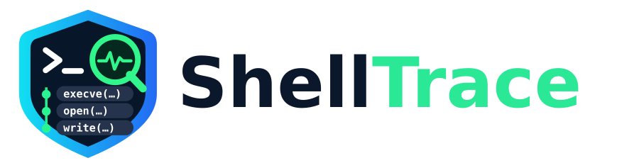

# ShellTrace

<picture>
  <source media="(prefers-color-scheme: dark)" srcset="assets/shelltrace-wordmark-dark.svg">
  
</picture>


**Know what a command really does before you trust it.**

[](https://github.com/hamdyaea/ShellTrace/actions/workflows/ci.yml)
[](LICENSE)

**ShellTrace** is an open-source **Rust CLI for Linux** that observes how a command behaves and documents its effects with evidence. It combines **before/after filesystem snapshots** with **`strace` syscall observations**. It does **not** claim to see every change to a machine.

**Two execution modes:**

- **`run` — observe on the actual host.** The command runs with your normal privileges and can **modify the host**. Before/after comparisons cover a directory you choose, while tracing can reveal paths referenced outside it.
- **`sandbox` — trial execution using Bubblewrap.** Runs in a separate namespace, with a read-only bind of the host root, a writable ephemeral `/tmp/shelltrace-work`, no shared network namespace, and masked home/runtime mount points. Not a hardened security boundary or a guarantee against all side effects.

## What ShellTrace reports

| Signal | Method | Evidence and caveats |
|---|---|---|
| Created/deleted paths | Before/after snapshots | Confirmed **within the watched directory** at snapshot times |
| Modified files | SHA-256, file size, modes, timestamps | Hash comparison confirms content differences for files within the configured size limit |
| File operations | `strace` path syscalls | Observed *attempts*; a successful call does not guarantee durable on-disk changes |
| Child processes | `execve`, `clone`, `fork`, etc. | Observed process-related syscall results |
| Network operations | `connect`, `bind`, `listen`, `accept` | Observed socket operations; **not** a packet capture or proof of successful application-layer communication |
| Sensitive path access | `.ssh`, `.aws`, `.gnupg`, `.kube`, `/etc/shadow`, `.env`, etc. | Heuristic path matching, not a security verdict |

In sandbox mode, ShellTrace attributes successful target `execve` events to the command; syscalls before a confirmed target exec can remain `unknown`. It separates known Bubblewrap setup events, but this is **not a complete parent/child attribution model**. The `AF_NETLINK` bind used by Bubblewrap is classified as kernel IPC, **not** Internet traffic.

ShellTrace does **not** reconstruct operations from unfinished/resumed `strace` lines, intercept kernel-only side effects, see writes to other machines, or inventory all file changes outside `--scope`. Background descendants may outlive the traced leader. Files can change concurrently for unrelated reasons, so a snapshot diff shows **what changed**, not necessarily which process caused it. Tracing is best-effort, not proof of causality.

## Desktop application — Qt6

ShellTrace now includes an **optional native Qt6 Widgets GUI** for people who prefer a visual workflow. It uses the same Rust tracing engine, launches commands asynchronously, and presents a dashboard with changes, processes, networking and sensitive-path events.

On Manjaro / Arch / CachyOS:

```bash
sudo pacman -S --needed rust strace bubblewrap cmake qt6-base
git clone https://github.com/hamdyaea/ShellTrace.git
cd ShellTrace
bash scripts/build-gui.sh
./build/gui/shelltrace-gui
```

For a launcher in the application menu, install both executables into your user profile (no sudo):

```bash
bash scripts/install-gui.sh
```

You can later uninstall with `bash scripts/install-gui.sh --uninstall`.

Appearance: **Dark (default)**, **Light**, or **System**, selectable in the top-right menu. The preference is remembered between sessions. The selected shield badge is used in the window and application launcher.

The GUI defaults to **Sandbox** and requires confirmation before executing a command on the real host. The GUI is **English-only**, regardless of Linux locale. Commands being inspected keep their original locale to preserve observed behavior. See [Qt6 GUI documentation](gui/README.md).

## Installation

**Requirements:** Linux, Rust toolchain (`cargo`), and [`strace`](https://strace.io/). The `sandbox` subcommand additionally requires [`bubblewrap`](https://github.com/containers/bubblewrap) (`bwrap`) and working unprivileged user namespaces.

On Arch Linux, CachyOS, Manjaro:

```bash
sudo pacman -S --needed rust strace bubblewrap
```

On Debian/Ubuntu:

```bash
sudo apt update
sudo apt install cargo rustc strace bubblewrap
```

> Rust **1.85+** is required by the manifest; distribution `cargo` packages may be older. Use rustup where needed.

Build from source:

```bash
git clone https://github.com/hamdyaea/ShellTrace.git
cd ShellTrace
cargo build --release
./target/release/shelltrace --help
```

## Quick start — host observation

Create a disposable test directory:

```bash
mkdir -p /tmp/shelltrace-demo
shelltrace run \
  --scope /tmp/shelltrace-demo \
  --json /tmp/shelltrace-report.json \
  -- /bin/sh -c 'printf "hello\n" > /tmp/shelltrace-demo/new.txt'
```

Or use the locally built executable with `./target/release/shelltrace` instead of `shelltrace`. **Commands in `run` mode are executed for real.**

Typical console output (illustrative; exact runtime and operation counts vary):

```text
ShellTrace 0.3.0 · Host observation
Watched directory: /tmp/shelltrace-demo
Files  1 created · 0 changed · 0 deleted · 0 uncertain
FILES CHANGED (snapshot comparison)
  + created  new.txt
    after: file 6 B mode=0644 sha256=...
```

## Quick start — sandbox trial

```bash
shelltrace sandbox \
  --json /tmp/shelltrace-sandbox.json \
  --export-workspace /tmp/shelltrace-results \
  -- /bin/sh -c 'echo sandbox-test > result.txt; cat result.txt'
```

To copy a project into the temporary workspace before execution:

```bash
shelltrace sandbox --seed ./example-project --json /tmp/try.json -- \
  /bin/sh -c 'echo changed > result.txt'
```

- `/tmp/shelltrace-work` is writable and its contents are inspected after the command finishes.
- The shell's cwd is `/tmp/shelltrace-work`. Absolute paths from the host may exist read-only inside the sandbox, with selected sensitive directories masked.
- Network namespaces are separated. The command usually cannot reach external networks.
- Optional sandbox masks (for example `/media` and `/mnt`) are mounted only if those directories exist on the host. Missing mount targets are skipped rather than triggering a Bubblewrap failure.
- The sandbox can fail where user namespaces, mount namespaces, or ptrace are disallowed. Failures are not silently bypassed.
- Exporting a workspace is optional; `--export-workspace` must point to a **new directory**.

**Warning:** This example sandbox is designed for **inspection, not hostile-code containment**. It does not use seccomp; portions of the host root are still readable. Do not execute malicious or untrusted software expecting full isolation. Use a disposable VM for high-risk samples. See [SECURITY.md](SECURITY.md).

## CLI synopsis

```text
shelltrace run [--scope DIR] [--allow-root-scope] [--json FILE]
               [--keep-trace DIR] [--max-hash-mib N] [--verbose] [--no-color] -- COMMAND [ARG...]

shelltrace sandbox [--seed DIR] [--export-workspace NEW_DIR]
                   [--json FILE] [--keep-trace DIR] [--max-hash-mib N] [--verbose] [--no-color]
                   -- COMMAND [ARG...]
```

`--keep-trace` saves the **raw syscall logs**, which can reveal file paths, command arguments, addresses and other confidential information. The default deletes them after generating the report. Files above `--max-hash-mib` are not hashed: same-size modifications may not be detected reliably. CLI and JSON reports have an event limit of 20,000 observations; the report includes `observations.truncated` when reached.

ShellTrace returns the executed command's exit status (or `1` for program errors). A nonzero exit status does not itself mean no files were changed.

## JSON output

The **v2 JSON envelope** adds `before`/`after` file metadata and conservative `origin` fields on each syscall event. `origin` is `command`, `sandbox_setup` or `unknown`. Network entries include a `category` (`internet`, `local_ipc`, `kernel_ipc`, `unknown`) and `succeeded` (based on syscall return, not remote protocol success). The envelope contains:

```json
{
  "schema_version": 2,
  "mode": "host",
  "started_at_unix": 0,
  "duration_ms": 0,
  "command": ["/bin/true"],
  "scope": "/tmp/shelltrace-demo",
  "exit_code": 0,
  "filesystem_changes": [
    {
      "path": "new.txt",
      "kind": "created",
      "evidence": "path appeared",
      "before": null,
      "after": {
        "file_type": "file",
        "size_bytes": 6,
        "mode": 420,
        "sha256": null,
        "symlink_target": null
      }
    }
  ],
  "observations": {
    "filesystem_operations": [],
    "process_events": [],
    "network_events": [],
    "sensitive_accesses": [],
    "truncated": false
  },
  "warnings": [],
  "raw_trace_path": null
}
```

The example above illustrates the **schema**, not measurements. The octal permission mode `0644` is represented as integer `420` in JSON. `before` and `after` describe metadata/hash snapshots, not backups of file contents. `--verbose` reveals individual command calls; by default the CLI hides most setup noise and displays concise counts. A trace result's `result` field contains the raw syscall return value; negative/error returns indicate failed attempts. The `filesystem_changes` array contains types such as `created`, `deleted`, `modified`, `metadata_changed`, `possibly_modified`, `type_changed`.

## Develop and contribute

```bash
cargo fmt --all -- --check
cargo clippy --all-targets -- -D warnings
cargo test --all-targets
cargo build --release
```

See [CONTRIBUTING.md](CONTRIBUTING.md), [SECURITY.md](SECURITY.md), and [CHANGELOG.md](CHANGELOG.md). Please report incomplete or incorrect evidence rather than assuming absence of evidence proves absence of behavior.

Author: **Hamdy Abou El Anein** · [GitHub](https://github.com/hamdyaea) · [Daylight GNU/Linux](https://daylightlinux.ch)

Licensed under **GNU GPL version 3 or later**. See [LICENSE](LICENSE).

**Note:** Place `--keep-trace` outside the watched `--scope` directory to avoid mixing ShellTrace's own evidence files with target-command changes. The CLI rejects an obviously nested trace output directory.

## Publishing from a local checkout

The optional helper `bash scripts/publish-github.sh` creates the public `hamdyaea/ShellTrace` repository (if absent) and pushes `main`, provided `git` and an authenticated GitHub CLI (`gh auth login`) are available. It does **not** force-push. Publishing to a repository containing unrelated commits can require a manual merge first.

## Linux distribution packages

Four native `.deb` builds are produced for Debian 12, Debian 13, Ubuntu 24.04 and Ubuntu 26.04. Each one embeds the Qt6 GUI, CLI and shield icon, with runtime dependencies calculated for its own distribution. The `shelltrace-git` AUR build installs the same components on Arch and Manjaro. See [packaging instructions](packaging/README.md).
